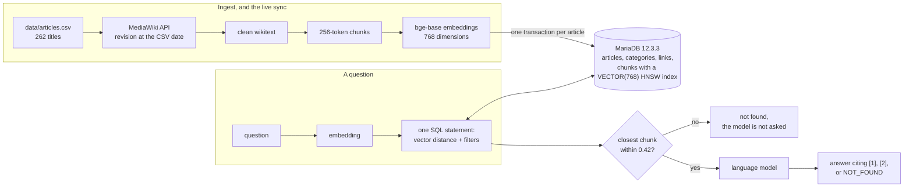
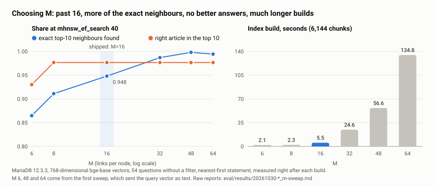
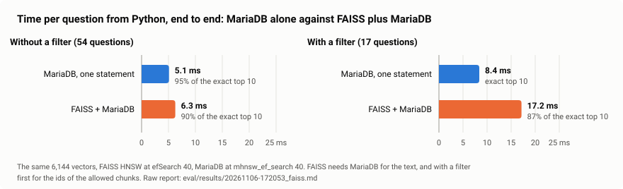

A project for area 4, "Vector search and RAG, natively" for the [MariaDB student database projects, 2026-09](https://mariadb.org/bachelor_hackathon_2026-09/).

# UEZA: Wikipedia question answering inside MariaDB

UEZA answers questions about 262 English Wikipedia articles on artificial intelligence. The article text, its metadata and the embedding vectors all live in MariaDB 12.3.3: the chunks sit in a `VECTOR(768)` column with an HNSW `VECTOR INDEX`, and one SQL statement finds the closest chunks and applies the filters at the same time. A language model then answers from those chunks and names its sources, or says that the answer is not in the articles.

**Main results** (details in [Results](./docs/evaluation/Results.md)):

- The right article is among the 10 closest chunks for 95% of the 60 answerable test questions, and in first place for 62%: the same as an exact search over every chunk.
- A search takes 8 ms on average without a filter and 12 ms with one (p95 12 and 24 ms), measured from Python against MariaDB in Docker. The vector index returns 95% of the exact 10 nearest chunks.
- Three things about MariaDB's vector search made it up to 25 times faster or more accurate on our data, each tested by changing that one thing ([What we learned](#what-we-learned-about-the-vector-index)): sending the query vector as binary instead of text, taking the nearest chunks before the join, and keeping the index's cache and statistics right.
- `M=16` with `mhnsw_ef_search` 40: `M=32` returns 4 more of every 100 exact neighbours but takes 4.5 times as long to build, and does not find the right article more often ([Choosing M](./docs/database/Choosing-M.md)).
- Next to FAISS on the same vectors, MariaDB loses on raw search speed and wins once the application needs the text and the filters: FAISS plus a query for the text took 6.3 ms per plain question against MariaDB's 5.1 ms, and a filtered question 17 ms and 87% of the exact answer against 8.4 ms and the exact answer ([FAISS Baseline](./docs/database/FAISS-Baseline.md)).
- Not one of the 11 unanswerable questions got an answer: the distance threshold rejected 8 and the language model answered `NOT_FOUND` for the other 3. The small local model we used (`qwen2.5:3b`) also refused 18 of the 60 answerable ones ([Answers](./docs/evaluation/Results.md#answers-with-the-language-model)).
- A live sync checks all 262 articles against Wikipedia in 2.7 s and loads only the changed ones again; 184 had changed since our snapshot ([Live sync](./docs/evaluation/Results.md#live-sync)).

## Quick start

You need Docker with Compose, `make` and [uv](https://docs.astral.sh/uv/). uv installs Python 3.14 by itself. The database is the `mariadb:12.3.3` image from `docker-compose.yml`, the version everything here was developed and measured with.

```bash
make quickstart
```

That one command copies `.env.example` to `.env`, installs the Python environment, starts MariaDB (`schema.sql` runs on the first start), loads 3 articles and starts the web app. The first run also downloads the embedding model, about 440 MB. The same steps one by one: `make setup`, `make db-up`, `make ingest-test`, `make run`.

Open <http://localhost:8000>, type a question and press **Search only**. The page shows the closest chunks with their cosine distance and needs no language model. The same search is available as `GET /search?q=...`.

**Ask** (`POST /ask`) also writes an answer, and needs an OpenAI-compatible language model. It can be a free local one, for example [Ollama](https://ollama.com) after `ollama pull qwen2.5:3b`, with these lines in `.env`:

```
LLM_API_BASE_URL=http://localhost:11434/v1
LLM_MODEL=qwen2.5:3b
LLM_API_KEY=ollama
```

The whole corpus and the evaluation:

```bash
make ingest            # all 262 articles; about an hour on our laptop CPU
make ingest-check      # every article present, chunks complete, no orphan rows
make eval              # Recall@K, MRR, latency, not-found analysis
make reindex           # rebuild the vector index (make ingest does it after replacing articles)
make ingest-sync-dry-run   # which articles changed on Wikipedia
make ingest-sync           # load only those again, at their latest revision
uv run python -m src.evaluation faiss           # FAISS on the same vectors, next to MariaDB
uv run python -m src.evaluation answers         # every question through the language model
```

One article of the snapshot has since been deleted from Wikipedia, so a fresh `make ingest` loads 261 of the 262 articles (6,127 chunks) and reports the missing one as a failure. The results in this README were measured on all 262; a fresh run on the 261 gave the same Recall@10 (0.950) and MRR (0.733).

`docker-compose.yml` starts MariaDB with two vector settings, `mhnsw_ef_search=40` and a 64 MB index cache. If your database container was created before they were added, `docker compose up -d --wait db` recreates it with them; the data stays in its volume.

If port 3306 is already taken, for example by a MariaDB installed on the machine, set `MARIADB_PORT=3307` in `.env`. `make help` lists every target. On Windows without `make`, run the commands behind each target in the [Makefile](./Makefile); [Ingestion](./docs/ingestion/Home.md) lists the ingest command and its options. To run the database with Podman on Windows, see [Installing Podman on Windows](./docs/database/podman.md). The whole stack in Docker is `make up`; what runs inside it and what runs on the host is in [Docker and Compose](./docs/development/Docker.md).

## Architecture



- **Ingestion** (`src/ingestion/`): MediaWiki client, cleaning, chunking, and a live sync that reloads only changed articles.
- **Storage** (`schema.sql`, `src/database/`): four tables; the chunks sit in a `VECTOR(768)` column with an HNSW index.
- **Retrieval and RAG** (`src/rag/`): the search statement, the distance threshold, the prompt and the language model client.
- **API** (`src/api/`, `src/main.py`): FastAPI endpoints and a small web page.
- **Evaluation** (`src/evaluation/`): ground truth, Recall@K, MRR, latency, index recall, the FAISS baseline and the language model's answers.

The modules, their dependencies and the two data flows are in [Architecture](./docs/architecture/Home.md).

## What it does

- **Hybrid search**: `GET /search` returns the closest chunks of the 262 articles, optionally constrained by SQL filters, with no language model needed.
- **Question answering**: `POST /ask` answers from the retrieved chunks, cites its sources, or says that the answer is not in the articles.
- **Live sync**: checks every stored article against Wikipedia and reloads only the changed ones.
- **Evaluation**: 71 ground-truth questions, Recall@K, MRR, latency, index recall, not-found analysis, a FAISS baseline and the language model's answers.
- **Index tuning**: query format, statement shape, `M`, `mhnsw_ef_search`, cache size and graph statistics, each measured on the real embeddings.

## One search, one statement

A question without a filter becomes this statement ([src/rag/retriever.py](./src/rag/retriever.py)):

```sql
SELECT c.id, a.title, c.chunk_text, n.distance
FROM (SELECT id, VEC_DISTANCE_COSINE(embedding, X'3a1f...') AS distance
      FROM article_chunks ORDER BY distance LIMIT 10) n
JOIN article_chunks c ON c.id = n.id
JOIN articles a ON a.id = c.article_id
ORDER BY n.distance;
```

The derived table gives the vector index its own `LIMIT 10`, `X'...'` is the query vector in the binary format of a `VECTOR` column, and every filter value is a bound parameter. A question with filters keeps them in one `WHERE`, and MariaDB then plans the search from the filter. The filters (category, root category, article length, edit date, "linked from"), why the statement is written this way and the exact search used as a baseline are in [Retrieval and RAG](./docs/rag/Home.md#the-search-statement).

To try the technique by hand, `make example` runs [examples/vector_search.sql](./examples/vector_search.sql) in the MariaDB client: ten hand-made chunks with 4-dimensional vectors you can read, a nearest-neighbour search, the query vector in binary, a filter and a join in the same statement, the exact search, and a transaction that rolls a vector back. Each query says what it should return, and an integration test checks that it does. It creates and drops its own tables.

## What we learned about the vector index

Each point was tested by changing that one thing and nothing else. The numbers are in [Findings](./docs/database/Findings.md).

- **Send the query vector as binary.** MariaDB evaluates `VEC_FromText('[...]')` again for every row it compares. Written as a hex literal of its binary value, the same search returned the same chunks for all 71 questions, and a full scan went from 608 to 24 ms, filtered searches from 95 to 12.6 ms.
- **Take the nearest chunks first, then join.** With `articles` joined in the same `SELECT`, the index searched far more of the graph than the 10 rows needed and ignored `mhnsw_ef_search` (32 to 67 ms). With the nearest chunks taken first in a derived table, a search takes 0.3 ms inside MariaDB and `M` and `mhnsw_ef_search` behave as in any HNSW index.
- **`M=16` with `mhnsw_ef_search` 40.** `M=32` returns 4 more of every 100 exact neighbours, but takes 4.5 times as long to build and does not find the right article for one question more ([Choosing M](./docs/database/Choosing-M.md)).
- **After a rebuild, InnoDB thinks the graph is empty.** `ADD VECTOR INDEX` leaves the hidden graph table with the statistics of 0 rows, and after a restart MariaDB sizes every search by that number: index recall stayed near 0.9 for every `M`. Inserting and deleting one row after the rebuild makes InnoDB count the table; `make reindex` does that. Reported as [MDEV-42430](https://jira.mariadb.org/browse/MDEV-42430).
- **Deleted vectors stay in the graph until a rebuild.** After every chunk was replaced, the graph no longer fit the default 16 MB index cache, which MariaDB then drops after every search. We run with 64 MB and rebuild after large changes; with the nearest-first statement, replacing every chunk now costs about 3 ms per search. Reported as [MDEV-42431](https://jira.mariadb.org/browse/MDEV-42431).
- **With a filter, MariaDB starts from the filter.** It reads the chunks of the matching articles and computes their distances, so filtered searches are exact.



## Why MariaDB and not a separate vector store

- **Filters and the vector search are one statement.** A filtered question takes 8.4 ms and gets the exact answer. FAISS has no metadata, so it first needs the ids of the allowed chunks from MariaDB: 17.2 ms and 87% of the exact answer. The usual shortcut, "fetch the 10 nearest chunks, then filter", returned fewer than 10 chunks for 16 of the 17 filtered questions ([FAISS Baseline](./docs/database/FAISS-Baseline.md)).
- **Joins with the rest of the data.** "Linked from article X" is a join over the links table. A separate vector store would need the links copied into its metadata and kept in sync.
- **One transaction per article.** The ingest and the sync replace an article's metadata, categories, links, chunks and vectors together, so there is no second system to update and no moment in which the two disagree. FAISS's HNSW index cannot even delete a vector.
- **One system** to run, back up and secure.



## Where this approach loses

- **A separate index searches faster.** FAISS's HNSW search took 0.09 ms, MariaDB's 0.46 ms inside the server, and FAISS built the index 9 times faster (0.6 s against 5.5 s). An application that needs no text and no filters from a database is faster with FAISS.
- **The index needs looking after.** Deleted vectors, the small default cache and the statistics after a rebuild each first showed up as a puzzling measurement. We work around all three, but a team that does not measure would not notice them.
- **Small details decide the speed, and `EXPLAIN` shows neither.** The vector as text made searches up to 25 times slower; the join in the same `SELECT` made the index search most of the graph.
- **The query vector is part of the SQL text.** The driver cannot send bytes as a parameter, so each search carries a 6 KB hex literal, built from validated floats only.
- **Weak filters scan, and large `M` rebuilds slowly.** A filter that keeps most of the table still gets the exact plan, at most the cost of a full scan here but growing with the corpus; `M=64` takes 135 s to build.
- **One vector index per table, tied to one dimension.** Comparing a 384-dimensional model needs a second table.
- **Not measured:** concurrent searches, the memory of the index and a larger corpus.

## Data model

Four tables, created by [schema.sql](./schema.sql): `articles` (the metadata we filter on, and the `revision_id` the sync compares), `article_categories`, `article_links` and `article_chunks`, which holds the text and the `VECTOR(768) NOT NULL` column with `VECTOR INDEX (embedding) M=16 DISTANCE=cosine`.

- Categories and links have their own tables, so a filter is an `EXISTS` and an article never appears twice in the results. Links are stored as titles, because most point outside our dataset; "linked from" then works whatever order the articles are loaded in.
- `embedding` is `NOT NULL` because MariaDB only indexes a vector column that cannot be NULL, and the index is `DISTANCE=cosine` because a search with `VEC_DISTANCE_COSINE` cannot use the default euclidean one.
- `article_chunks` is only ever the child side of a foreign key: MariaDB has an open bug (MDEV-35241) about dropping a table with a vector index that other tables reference.

Every column and where it comes from: [Data Model](./docs/database/Data-Model.md).

## Documentation

[All documentation](./docs/Home.md) has the full index. The main pages:

- [Architecture](./docs/architecture/Home.md): modules, dependency directions, the ingest and query flows
- [Data decisions](./docs/data_decisions.md): topic, the 262 articles, cleaning and chunking rules
- [Ingestion](./docs/ingestion/Home.md): MediaWiki client, cache, rate limiting, live sync
- [Database](./docs/database/Home.md): [data model](./docs/database/Data-Model.md), [schema management](./docs/database/Schema.md), [vector search and index parameters](./docs/database/Vector-Search.md), [vector index state](./docs/database/Index-State.md), [choosing M](./docs/database/Choosing-M.md), [FAISS baseline](./docs/database/FAISS-Baseline.md)
- [Findings](./docs/database/Findings.md): what we learned about the vector index, why MariaDB, where it loses, in more detail
- [Worked example](./examples/vector_search.sql): the technique in one SQL file, `make example`
- [Retrieval and RAG](./docs/rag/Home.md): the search statement, the prompt, the not-found logic, the API
- [Evaluation](./docs/evaluation/Home.md) and [Results](./docs/evaluation/Results.md): ground truth, metrics, method, measured results; [raw reports](./eval/results/README.md)
- [Development](./docs/development/Home.md): Docker, CI, Git hooks, [scripts and experiments](./docs/development/Scripts.md)

## Status

Done:

- schema and vector index, ingest of a fixed snapshot, hybrid search, the question-answering API and page
- evaluation: Recall@K, MRR, latency, index recall, not-found analysis on 71 questions
- index tuning on the real embeddings: query format, statement shape, `M` and `mhnsw_ef_search`, cache size, graph statistics
- the FAISS baseline on the same vectors
- live sync with Wikipedia, and the effect of partly replaced chunks on the index
- the language model's `NOT_FOUND` answers on the same questions
- a worked SQL example, a stand-alone write-up of the `M` choice, and charts drawn from the reports (`make charts`)
- a web page that says why an answer was not found: the distance threshold, or the model
- the two index behaviours reported to MariaDB: [MDEV-42430](https://jira.mariadb.org/browse/MDEV-42430) (graph statistics after a rebuild) and [MDEV-42431](https://jira.mariadb.org/browse/MDEV-42431) (the whole-cache reset)

Not done, as future work:

- chunk sizes (configs B and C) and other embedding models compared on the same questions; each needs a full re-ingest, and another dimension needs a second table
- a larger language model, or a less strict prompt, against the refusals of the 3B model
- concurrent searches and a larger corpus

## Team

- **Aaryadeep**: database schema, vector column and index, similarity search and filtered SQL queries
- **Zeynalabidin**: data decisions (topic, article list, metadata, cleaning and chunking rules) and the ground-truth question set
- **Egehan**: ingestion and live sync (MediaWiki client, chunking, embeddings, loading into MariaDB), the FAISS comparison baseline, the Docker Compose stack and CI
- **Umid** (team lead): repo structure, RAG pipeline and backend, evaluation, final integration

## License

The code is released under the [MIT License](./LICENSE).

The article text comes from English Wikipedia, under [CC BY-SA 4.0](https://creativecommons.org/licenses/by-sa/4.0/). The repository does not contain it: it stores only the article titles, page ids and metadata (`data/articles.csv`) and our own questions, and the ingest fetches the text from the MediaWiki API. The embedding model `BAAI/bge-base-en-v1.5` is under the MIT License.
