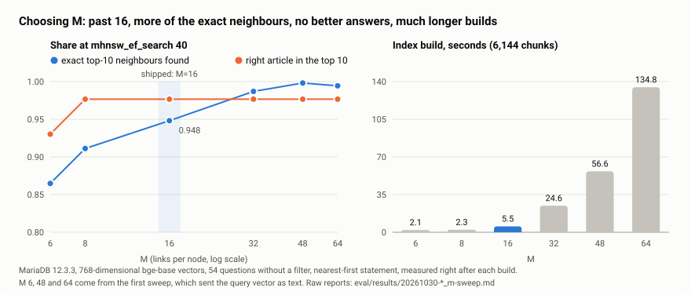

# Choosing M for a MariaDB vector index

[← Database](./Home.md) | [Documentation Home](../Home.md)

A write-up for readers outside this project: what `M` and `mhnsw_ef_search` did on 6,144 real embeddings, which values we ship and why, and the three things that made our first M measurements wrong. The details and every table are in [Vector Search and Index Parameters](./Vector-Search.md); this page is the short version, meant to stand on its own.

## The question

A MariaDB `VECTOR INDEX` is an HNSW graph with one build parameter and one search parameter:

- `M`, the number of links each node keeps (`VECTOR INDEX (embedding) M=16`; MariaDB's default is 6, `mhnsw_default_m`). Larger `M` gives a better graph and a slower build.
- `mhnsw_ef_search`, how many candidates a search keeps (default 20). Larger values give more accurate results and slower searches.

The documentation explains what both do but not how to choose them, and a retrieval system cares about something the index cannot see: whether the passage that answers the question is among the results.

## The answer, for our data

**`M=16` with `mhnsw_ef_search` 40.** It returns 95% of the exact 10 nearest chunks, and for 42 of 43 answerable questions it finds a chunk of the right article in the top 10, exactly as many as a full scan. The index builds in 5.5 s.

`M=32` returns 4 more of every 100 exact neighbours (98.7%), but takes 4.5 times as long to build (24.6 s) and does not find the right article for a single question more. `M=48` and `M=64` take 10 and 25 times as long.



| M | Build | Exact top 10 found, at `mhnsw_ef_search` 20 / 40 / 80 | Right article in the top 10, at 20 / 40 / 80 |
| --- | --- | --- | --- |
| 6 | 2.1 s | 0.819 / 0.865 / 0.904 | 0.930 / 0.930 / 0.977 |
| 8 | 2.3 s | 0.861 / 0.911 / 0.926 | 0.930 / 0.977 / 0.977 |
| **16** | **5.5 s** | **0.911 / 0.948 / 0.972** | **0.954 / 0.977 / 0.977** |
| 32 | 24.6 s | 0.974 / 0.987 / 0.991 | 0.977 / 0.977 / 0.977 |
| 48 | 56.6 s | 0.989 / 0.998 / 1.000 | 0.977 / 0.977 / 0.977 |
| 64 | 134.8 s | 0.987 / 0.994 / 1.000 | 0.977 / 0.977 / 0.977 |

A full scan finds the right article for 0.977 of the questions, the ceiling of the last column. From `M=8` at `mhnsw_ef_search` 40 on, the neighbours the index missed never cost a question its right article.

## Two recalls, and which one decides

- **Index recall@10**, the share of the exact 10 nearest chunks the index returned, measures the index. It keeps rising with `M`.
- **Recall@10**, the share of questions with a chunk of the right article in the top 10, measures retrieval. It stopped rising at `M=8` with `mhnsw_ef_search` 40, and at `M=16` the smaller `mhnsw_ef_search` 20 is the only setting that still loses a question.

So the second recall decides, and the build time breaks the tie. Build time matters more than it seems: an index is rebuilt after large changes (deleted vectors stay in the graph until then, see [Vector Index State](./Index-State.md)), and a live sync makes rebuilds regular.

## Three things that made our first measurements wrong

Each of these changed the result of an M sweep for us before we found it. Anyone repeating the measurement should rule them out first.

1. **The statement shape.** With the join to the articles table in the same `SELECT`, every `M` and every `mhnsw_ef_search` returned the exact top 10, and the search took 32 to 67 ms: MariaDB searched far more of the graph than the 10 rows needed. Only with the nearest chunks taken first, in a derived table with its own `LIMIT`, did `M` and `mhnsw_ef_search` behave as they do in any HNSW index ([Statement shape](./Vector-Search.md#statement-shape-join-or-nearest-chunks-first)).
2. **The graph table's statistics after a rebuild.** `ALTER TABLE ... ADD VECTOR INDEX` leaves the hidden graph table with InnoDB statistics of 0 rows, and after a restart MariaDB sizes each search by that number: index recall stayed around 0.90 for every `M`. Inserting and deleting one row after the rebuild makes InnoDB recount the table ([Cause 2](./Index-State.md#cause-2-the-graph-tables-statistics-after-a-rebuild)). The table above is measured right after each build, which is what a restart gives once the statistics are right.
3. **The query vector as text.** MariaDB evaluates `VEC_FromText('[...]')` again for every row it compares. It costs little on an index search but a lot on a full scan, the reference every recall is measured against: 608 ms against 24 ms with the vector as a binary hex literal ([text or binary](./Vector-Search.md#the-query-vector-text-or-binary)).

## How to choose for your own data

What we would do again, in order:

1. Write a small set of questions whose right source is known, as our 71 ([ground truth](../evaluation/Home.md)).
2. Measure the full scan first (`ORDER BY distance + 0`), with the query vector as binary. It is the reference for both recalls.
3. Sweep `M` with the nearest-first statement, and refresh the graph statistics after every build.
4. Take the smallest `M` whose answer recall equals the full scan's at an `mhnsw_ef_search` you can afford, and check it once more after a restart.

## Limits

- One corpus of 6,144 chunks of 768 dimensions, one machine, MariaDB 12.3.3, sequential searches. A larger corpus can need a larger `M`; the build times will grow with it.
- The table is measured right after each build. The state after a restart, with the statistics refreshed, was measured for `M=16` only (0.954 at `mhnsw_ef_search` 40).
- `M` 6, 48 and 64 come from the first sweep, which sent the query vector as text. That adds a few milliseconds to a search; text and binary returned the same chunks for all 71 questions.
- 43 answerable questions without a filter: one question is 2.3 points of Recall@10.

## Reproducing it

```bash
make ingest                                   # the 262 articles, 6,144 chunks
uv run python -m src.evaluation m-sweep --m 6 8 16 32 48 64 --ef 20 40 80
make charts                                   # redraws the chart above from eval/results
```

Raw reports: [first sweep](../../eval/results/20261030-201017_m-sweep.md), [second sweep](../../eval/results/20261030-203723_m-sweep.md), [after a restart](../../eval/results/20261030-204644_final-ef-sweep.md).
